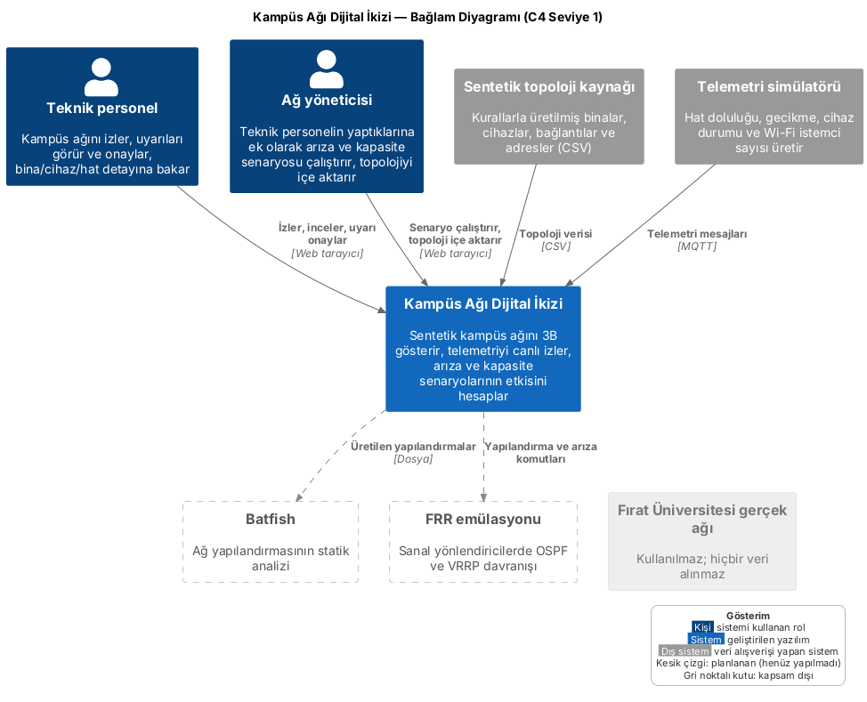
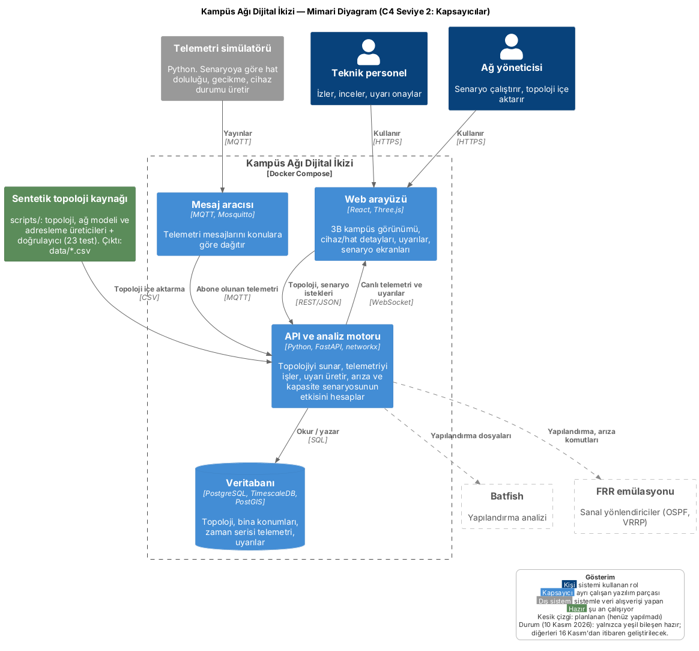

# Sistem Bağlamı ve Mimari

Bu belge iki diyagramı açıklar. Diyagramlar C4 modeline göre çizilmiştir (Brown, *The C4 model for visualising software architecture*, c4model.com). C4, bir yazılımı yakından uzağa doğru seviyelerle anlatır. Burada ilk iki seviye kullanılmıştır:

- **Seviye 1, Bağlam:** Sistem tek bir kutudur. Kimin kullandığı ve hangi dış sistemlerle konuştuğu gösterilir.
- **Seviye 2, Kapsayıcılar:** Sistemin içi açılır. Ayrı çalışan yazılım parçaları ve aralarındaki iletişim gösterilir.

Kaynak dosyalar: `docs/diagrams/baglam.puml`, `docs/diagrams/mimari.puml` (PlantUML + C4-PlantUML). Görseller aynı klasörde `.png` ve `.svg` olarak bulunur.

> **Durum (10 Kasım 2026):** Şu an yalnızca sentetik topoloji kaynağı (`scripts/` ve `data/`) çalışır durumdadır. Diyagramdaki diğer bileşenler planlanan mimaridir ve 16 Kasım 2026'dan itibaren geliştirilecektir. Fırat Üniversitesi'nin gerçek ağına hiçbir bağlantı yoktur.

## 1. Bağlam diyagramı

| Öğe | Tür | Sistemle ilişkisi |
|---|---|---|
| Teknik personel | Kişi | Ağı izler, uyarıları görür ve onaylar, bina/cihaz/hat detayına bakar (UC-01 – UC-08) |
| Ağ yöneticisi | Kişi | Teknik personelin yaptıklarına ek olarak geçmişi oynatır, arıza ve kapasite senaryosu çalıştırır, topolojiyi içe aktarır (UC-09 – UC-13) |
| Sentetik topoloji kaynağı | Dış sistem | Binalar, cihazlar, bağlantılar ve adresler CSV olarak sisteme verilir |
| Telemetri simülatörü | Dış sistem | Ölçüm verisini MQTT ile gönderir (UC-14) |
| Batfish | Dış sistem, planlanan | Üretilecek yapılandırmaların statik analizi |
| FRR emülasyonu | Dış sistem, planlanan | Sanal yönlendiricilerde OSPF ve VRRP davranışının denenmesi |
| Fırat Üniversitesi gerçek ağı | Kapsam dışı | Bağlantı yoktur; diyagramda bunun açıkça görülmesi için yer alır |

Kişiler ve simülatör, kullanım durumu diyagramındaki aktörlerle aynıdır (`docs/kullanim-durumlari.md`). Böylece iki diyagram birbiriyle tutarlıdır.

## 2. Mimari diyagram (kapsayıcılar)

| Kapsayıcı | Teknoloji | Görevi |
|---|---|---|
| Web arayüzü | React, Three.js | Kullanıcının gördüğü her şey: 3B kampüs, detay panelleri, uyarılar, senaryo ekranları |
| API ve analiz motoru | Python, FastAPI, networkx | Topolojiyi sunar, telemetriyi işler, eşik aşılınca uyarı üretir, "şu koparsa ne olur" hesabını yapar |
| Mesaj aracısı | MQTT, Mosquitto | Simülatörün ürettiği mesajları alıp API'ye iletir |
| Veritabanı | PostgreSQL, TimescaleDB, PostGIS | Topoloji, bina konumları (PostGIS), zamana bağlı telemetri (TimescaleDB), uyarılar |

Bütün kapsayıcılar Docker Compose ile tek komutla birlikte çalıştırılır.

**Veri nasıl akar?**

1. Topoloji (binalar, cihazlar, bağlantılar) CSV dosyalarından API aracılığıyla veritabanına yüklenir.
2. Simülatör her birkaç saniyede bir ölçüm üretir ve MQTT'ye yayınlar.
3. API bu mesajları alır, veritabanına yazar, bir eşik aşılırsa uyarı oluşturur.
4. Web arayüzü topolojiyi bir kez REST ile ister, canlı değişiklikleri WebSocket ile anında alır.
5. Kullanıcı bir arıza senaryosu seçtiğinde API etkiyi hesaplar ve arayüz etkilenen binaları gösterir.

**Neden bu teknolojiler?**

| Seçim | Gerekçe |
|---|---|
| MQTT | Telemetri gibi sık ve küçük mesajlar için tasarlanmış, hafif bir yayınla/abone ol protokolüdür |
| TimescaleDB | Zamana bağlı ölçümleri PostgreSQL içinde verimli saklar ve sorgular |
| PostGIS | Bina koordinatlarını ve mesafe hesaplarını veritabanında yapar |
| WebSocket | Sunucunun tarayıcıya sormadan veri göndermesini sağlar; canlı izleme için gereklidir |
| networkx | Doğrulama betiğinde zaten kullanılan grafik kütüphanesi; arıza etkisi hesabı aynen taşınır |
| Docker Compose | Bütün parçaları tek komutla, her bilgisayarda aynı şekilde çalıştırır |

## 3. Kapsam sınırı

- Gerçek ağ cihazlarından veri **alınmaz**; bütün telemetri simülatörden gelir.
- Kullanıcı girişi ve rol yönetimi bu prototipin kapsamında değildir (bkz. `docs/kullanim-durumlari.md`).
- Batfish ve FRR planlanan bileşenlerdir; veri modeli `docs/batfish_frr_hazirlik.md` belgesinde hazırdır.
